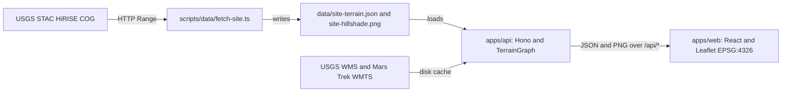

# Algorithms and architecture

This document covers the implemented terrain-graph prototype for Mars Mission Planner. All file paths, symbols, constants, formulas, HTTP endpoints, and test counts come directly from the codebase under `packages/shared`, `apps/api`, `apps/web`, and `scripts`.

## Monorepo layout

The root `package.json`, named `mars-mission-planner`, configures Bun workspaces across `apps/*` and `packages/*`.

```text
packages/shared/src/     Coordinate geodesy, basemap layer metadata, and shared TypeScript types for @nimbs/shared
apps/api/src/            Hono HTTP API, TerrainGraph engine, PNG encoder, and tile proxy for @nimbs/api
apps/web/src/            React and Leaflet console UI, ToolRegistry, and CSS design tokens for @nimbs/web
scripts/dev.ts           Process launcher running @nimbs/api with --hot and @nimbs/web Vite dev server
scripts/data/            Offline dataset ingestion script, fetch-site.ts
data/                    Gitignored terrain grid, hillshade PNG, tile cache, and tracked SOURCES.md
docs/                    Visual language, tool extension guide, and architecture documentation
```

`@nimbs/shared` exposes `coords.ts`, `layers.ts`, and `types.ts` directly as TypeScript through `packages/shared/src/index.ts`. Both `@nimbs/api` and `@nimbs/web` depend on `@nimbs/shared` via `workspace:*`.



## Technology stack

Each dependency keeps local tooling simple and avoids native compilation bottlenecks.

| Component | Version | Role and rationale |
| --- | --- | --- |
| Bun | `@types/bun` `1.2.5` | Runs workspace scripts, `Bun.serve`, and `bun:test`. Direct TypeScript execution removes a compile step for the API and ingest scripts. |
| Hono | `4.7.10` | Minimal typed router in `apps/api/src/index.ts` and `apps/api/src/routes/tiles.ts`. `app.request(...)` lets tests call routes in memory without binding a port. |
| React and Vite | `18.3.1` / `6.2.0` | Local dev server on port `5173` proxying `/api` to `http://localhost:3001` via `apps/web/vite.config.ts`. |
| TypeScript | `5.7.3` | `tsconfig.base.json` sets `strict: true`, `noUncheckedIndexedAccess: true`, `isolatedModules: true`, `target: "ES2022"`, and `moduleResolution: "bundler"`. |
| Biome | `1.9.4` | Formats with 2-space indentation and `lineWidth: 100` while running `recommended` lint rules across `apps`, `packages`, and `scripts`. |
| `geotiff` | `2.1.3` | Pure TypeScript COG reader used by `scripts/data/fetch-site.ts` over HTTP Range requests, avoiding GDAL bindings and full-scene downloads. |
| Custom PNG encoder | Node `node:zlib` | `apps/api/src/utils/png.ts` uses `deflateSync`, `DataView`, and a CRC32 table with polynomial `0xedb88320` to encode 8-bit RGBA PNGs with zero native image libraries. |
| Leaflet | `1.9.4` | Uses `L.CRS.EPSG4326` directly so USGS WMS tiles, Mars Trek WMTS tiles, and site `L.imageOverlay` masks align without Web Mercator reprojection. |

## Geodesy and site data pipeline

### Canonical Mars coordinates

`packages/shared/src/coords.ts` enforces one coordinate convention across ingest, routing, and display.

- **Latitude.** Planetocentric degrees clamped to `[-90, 90]` via `clampLat`, north positive.
- **Longitude.** East-positive degrees normalized into `[-180, 180)` via `normalizeLon180`, which maps `180` to `-180`. For UI display, `lon180To360` converts back to `[0, 360)`.
- **Reference sphere.** `MARS_RADIUS_M = 3_396_190` m, matching the Mars 2015 sphere used by USGS HiRISE COGs.
- **Equirectangular projection.** `equirectangularToCoord` and `coordToEquirectangular` convert between projected meters with `clon = 0` and `lat_ts = 0` and planetocentric degrees using `R = 3,396,190` m.
- **Great-circle distance.** `surfaceDistanceMeters(a, b)` applies the Haversine formula `2 * MARS_RADIUS_M * asin(min(1, sqrt(h)))`, normalizing longitudinal difference with `normalizeLon180(b.lon - a.lon)`.
- **Local degree scaling.** `metersToLatDeg` and `metersToLonDeg` convert metric widths to degrees, clamping `cos(lat)` to at least `1e-6`.

### Equirectangular DEM window extraction

`scripts/data/fetch-site.ts` extracts a local `3000 m x 3000 m` crop from multi-hundred-megabyte HiRISE COGs. It defines two site presets: `jezero` targeting `DTEEC_048842_1985_048908_1985_U01` near `lat 18.46, lon 77.523`, and `mount-sharp` targeting `DTEEC_063319_1745_052242_1745_A01` near `lat -5.48, lon 137.316`.

1. `fromUrl` opens the remote DTM COG header via HTTP Range requests, and `pickOverviewImage` chooses the coarsest IFD overview with pixel resolution `<= 12` m/px.
2. Because equirectangular projection stretches east-west meters away from the equator, the script sets `widthProjM = 3000 / max(0.1, cos(latRad))` and `heightProjM = 3000`.
3. The script probes 5 candidate windows around the image center at `[0, 0]`, `[0, -0.1*H]`, `[0, +0.1*H]`, `[-0.08*W, 0]`, and `[+0.08*W, 0]`. `isValidElevation` rejects non-finite values, values within `1e-3` of GDAL nodata, and values outside `[-20000, 30000]`. The script picks the candidate with `validRatio >= 0.995` and the largest elevation span.
4. Centered on that window's `projCenter`, the script computes an exact `3000 m x 3000 m` box, bilinearly resamples it to `151 x 151` via `overviewImg.readRasters`, and rounds heights to `0.01 m`. Rare edge nodata cells get sentinel `-99999` and are filled by averaging valid neighbors in a `5 x 5` kernel over `-2..2` or falling back to `minElevationM`.
5. For visual context, `pickOverviewImage` picks a `<= 6` m/px overview of the matching hillshade COG, reads a `600 x 600` crop at `5 m/px`, tints RGB channels by `[0.88, 0.83, 0.78]` with alpha `180` on `0` pixels and `225` elsewhere, and writes `data/site-hillshade.png` with `encodeRgbaPng`.

The fetched Jezero Crater Delta dataset in `data/site-terrain.json` contains `151` rows by `151` columns, `22,801` elevation nodes at `20 m` spacing across `150` intervals, bbox `[77.4863733373711, 18.4375029889216, 77.5397315290088, 18.488114803495947]`, center `{ lat: 18.462808896208774, lon: 77.51305243318996 }`, and elevations between `-2645.56 m` and `-2502.28 m`.

### Basemap tile proxy and disk caching

`apps/api/src/routes/tiles.ts` proxies and caches global basemaps at `GET /api/tiles/:layer/:z/:x/:y`.

- **Layer mapping.** `USGS_WMS_LAYERS` maps `usgs-mdim` to `MDIM21_color`, `usgs-themis` to `THEMIS`, `usgs-mola-themis` to `MOLA_THEMIS_blend`, and `usgs-hillshade` to `HRSC_MOLA_Blend_Hillshade`. `mola-trek` fetches NASA Mars Trek MOLA colorized shaded relief JPEGs for `z <= 7`. In `packages/shared/src/layers.ts`, `MARS_BASE_LAYERS` exposes `usgs-mdim`, `usgs-themis`, `usgs-mola-themis`, and `mola-trek` to the frontend, with `usgs-mdim` as `DEFAULT_MARS_BASE_LAYER`.
- **Tile grid validation.** `EPSG:4326` spans `360°` by `180°`, so valid tile indices satisfy `0 <= z <= 14`, `0 <= x < 2^(z+1)`, and `0 <= y < 2^z`.
- **WMS request math.** For USGS layers, `tileDeg = 180 / 2^z`, `west = -180 + x * tileDeg`, `east = west + tileDeg`, `north = 90 - y * tileDeg`, and `south = north - tileDeg`. The proxy requests `256 x 256` `image/png` tiles from `planetarymaps.usgs.gov/cgi-bin/mapserv` using `WMS 1.1.1` and `SRS=EPSG:4326`.
- **Disk cache.** Tiles persist at `data/cache/tiles/<layer>/<z>_<x>_<y>.<ext>` using `.jpg` for `mola-trek` and `.png` for USGS layers. Upstream calls enforce a `12,000 ms` `AbortSignal.timeout` and reject non-image `content-type` headers with `502`. Responses set `Cache-Control: public, max-age=86400` and `X-Tile-Cache: HIT` or `MISS`.

## Terrain graph and pathfinding algorithms

`TerrainGraph` in `apps/api/src/terrain/engine.ts` loads `SiteDataset` elevations into a row-major `Float32Array` ordered north-to-south and west-to-east. From `meta.bbox`, the constructor measures exact Martian surface spacing along the grid midlines:

```text
dyM = surfaceDistanceMeters({ lat: north, lon: midLon }, { lat: south, lon: midLon }) / max(1, rows - 1)
dxM = surfaceDistanceMeters({ lat: midLat, lon: west }, { lat: midLat, lon: east }) / max(1, cols - 1)
```

### Graph structure, step distance, and slope

- **Vertices.** Cell `(r, c)` has linear index `idx = r * cols + c`. A vertex is valid when its elevation is finite and exceeds `nodataValue + 10`. `coordForCell(row, col)` maps cell indices linearly back to `[south, north]` and normalized `[west, east]`.
- **8-connected edges.** `DIRS` connects each valid vertex to 4 cardinal and 4 diagonal neighbors `[dr, dc]`.
- **Step distance.** `stepDist(dr, dc) = hypot(dr * dyM, dc * dxM)`.
- **Edge slope.** `edgeSlopeDeg` computes unsigned grade in degrees:

```text
dh = |elevations[idxB] - elevations[idxA]|
slopeDeg = atan(dh / max(1e-6, distM)) * 180 / pi
```

- **Global passability ratio.** `computePassableEdgeRatio(maxSlopeDeg)` scans the 4 forward directions `[0, 1]`, `[1, 0]`, `[1, 1]`, and `[1, -1]` so each undirected valid edge is counted once, returning `round((passable / total) * 1000) / 1000`.

### Priority queue and A* search

`planRoutes` clamps `maxSlopeDeg` to `[0.5, 89]` and checks `isInsideBounds` for both endpoints. `snapToNode` rounds fractional grid coordinates to the nearest valid cell, expanding outward in square rings of radius `1..5` if the exact pixel is nodata.

`runAStar(startIdx, goalIdx, maxSlopeDeg, weightFn)` uses a custom binary `MinHeap` stored in parallel `nodes: number[]` and `scores: number[]` arrays, alongside `Float64Array` `gScore`, `Int32Array` `parent`, and `Uint8Array` `closed`. Any edge with `slope > maxSlopeDeg` is pruned. The heuristic estimates remaining distance in meters on the local grid plane:

```text
h(r, c) = hypot((r - goalR) * dyM, (c - goalC) * dxM)
```

Because every strategy weight function returns at least `stepDist`, `h` is admissible and never overestimates path cost.

### Three route strategies

`planRoutes` generates up to three distinct routes and deduplicates corridors using `overlapRatio(pathA, pathB) = sharedNodes / max(1, min(pathA.length, pathB.length))`.

1. **Shortest safe, `route-shortest`.** Strategy `"shortest"` uses `weightFn = (dist) => dist`. If no path exists under `clampedSlope`, `planRoutes` skips the remaining strategies and runs minimax Dijkstra.
2. **Lowest slope, `route-gentlest`.** Strategy `"gentlest"` penalizes steep steps quadratically relative to the limit:

```text
ratio = slopeDeg / max(1, clampedSlope)
cost = distM * (1 + 4.5 * ratio * ratio)
```

`planRoutes` appends this route only when `overlapRatio(gentlestPath, shortestPath) < 0.9`.

3. **Alternate corridor, `route-alternate`.** Strategy `"alternate"` builds a `Uint8Array` `penaltyMask` across a `5 x 5` block, offsets `dr = -2..2` and `dc = -2..2`, around every intermediate node of already discovered paths while excluding `startIdx` and `goalIdx`. Stepping onto a masked cell multiplies cost to `distM * 3.5`; unmasked steps cost `distM`. `planRoutes` appends this route only when `overlapRatio(alternatePath, existing) < 0.85` for all prior routes.

`buildRouteSummary` records `totalDistanceM`, `elevationGainM`, and `elevationLossM` rounded to `0.1 m`, `maxSlopeDeg` and distance-weighted `meanSlopeDeg` rounded to `0.01°`, plus per-node `RoutePoint` entries with 6-decimal coordinates and incoming segment slopes.

### Minimax Dijkstra for unreachable thresholds

When `shortestPath` returns `null`, `findMinRequiredSlope(startIdx, goalIdx)` finds the lowest slope limit that connects A to B. Using `Float32Array` `bestMaxSlope` and `MinHeap`, it relaxes neighbor edges with `candSlope = max(uSlope, edgeSlope)` and returns `ceil(top.score * 10) / 10` as `minRequiredSlopeDeg` when `goalIdx` is popped, or `null` if no valid cell path exists.

### Bilinear elevation lookup and passability masks

- **Bilinear interpolation.** `elevationAt(coord)` maps coordinates to fractional `(r, c)`. When all four surrounding corner indices `(r0, c0)`, `(r0, c1)`, `(r1, c0)`, and `(r1, c1)` are valid, it interpolates linearly in both axes and rounds to `0.01 m`. If any corner is nodata, it falls back to the nearest rounded cell if valid, or returns `null`.
- **Passability mask PNG.** `renderSlopeMaskPng(maxSlopeDeg)` finds `localMaxSlope` across each valid cell's 8 neighbors and encodes a `151 x 151` RGBA PNG via `encodeRgbaPng`:
  - `localMaxSlope > maxSlopeDeg` writes amber-orange `rgba(245, 158, 11, 175)`, keeping terrain hazards visually separate from the `#de233d` selection accent.
  - `localMaxSlope > maxSlopeDeg * 0.75` writes caution yellow `rgba(234, 179, 8, 55)`.
  - Safer cells remain transparent `rgba(0, 0, 0, 0)`.

## Frontend architecture

### ToolRegistry and layout structure

`apps/web/src/registry/toolRegistry.ts` manages rail tools via `ToolRegistry` methods `register`, `list` sorted ascending by `order`, and `get`. Following `docs/adding-tools.md`, `apps/web/src/App.tsx` registers three tools on the 64px vertical `.tool-rail`:

- `route`, rail label `RTE`, order `1`: waypoint readouts, `MaxSlopeControl`, route strategy buttons, summary stats, and `ElevationProfile`.
- `layers`, rail label `LYR`, order `2`: global basemap selector and toggles for the 3x3 km hillshade, slope hazard mask, and site bounding box.
- `settings`, rail label `SET`, order `3`: `MaxSlopeControl`, graph edge passability percentage, `-180..180` versus `0..360E` longitude display toggle, DEM grid stats, and a button to re-center on the 3x3 km patch.

When `panelOpen` is true, the `64px` `.tool-rail` plus `416px` `.side-panel` equals `480px`, matching `--sidebar-width` in `apps/web/src/styles/tokens.css`, and shifts `.map-hud` left offset from `64px` to `480px`.

### Leaflet alignment, overlays, and waypoint flow

`apps/web/src/components/MapView.tsx` initializes Leaflet with `crs: L.CRS.EPSG4326`, center `[18.46, 77.523]`, initial zoom `13`, `minZoom: 1`, `maxZoom: 17`, `zoomControl: false`, and `attributionControl: false`.

- Basemap `L.tileLayer` instances use `tileSize: 256`, `noWrap: true`, bounds `[[-90, -180], [90, 180]]`, and `maxNativeZoom` from `MapLayerMeta`.
- The 3x3 km `L.imageOverlay` for `/api/site/hillshade.png` at `opacity: 0.9`, `/api/site/passability.png?maxSlopeDeg=...` at `opacity: 0.78`, and the dashed `#fff8f3` `L.rectangle` share `site.bbox` bounds `[south, west]` to `[north, east]`.
- On `zoomend`, `moveend`, and `resize`, `updateScale` measures `surfaceDistanceMeters` across a `120 px` horizontal span at viewport center and picks the largest entry in `NICE_SCALE_METERS` from `50 m` to `500 km` that fits within `110 px`.
- Right-clicking the map prevents the browser context menu, normalizes longitude with `normalizeLon180`, and opens `apps/web/src/components/ContextMenu.tsx` clamped within `window.innerWidth - 230` and `window.innerHeight - 150`. Selecting Set A Waypoint or Set B Waypoint updates coordinates, switches to the `route` tool, and opens the side panel.
- Moving the pointer inside `site.bbox` triggers a `45 ms` debounced `GET /api/terrain/elevation` lookup for the top-right `ELEVATION` HUD readout.

### Reactive slope filtering and elevation profile

- `apps/web/src/components/MaxSlopeControl.tsx` binds a `1..45°` slider with `0.5°` steps to a `0.5..60°` numeric input with `0.5°` steps.
- Any change to `waypointA`, `waypointB`, or `maxSlopeDeg` triggers an `80 ms` debounced `POST /api/graph/routes` call with cancellation on superseded requests, while `MapView` updates the `/api/site/passability.png?maxSlopeDeg=...` overlay URL.
- Candidate polylines sort so the active `selectedRouteId` renders last on top in `#de233d` with weight `3.5` and opacity `0.96`; unselected candidates render as dashed `#fff8f3` lines with weight `2` and opacity `0.45`.
- `apps/web/src/components/ElevationProfile.tsx` renders a `328 x 128` SVG elevation profile, highlights steep segments where incoming `pt.slopeDeg > maxSlopeDeg * 0.8` in `#f59e0b`, and maps horizontal pointer position to the nearest `RoutePoint` by `distanceM` to place `.profile-hover-dot` on the map.

### Visual language alignment

`apps/web/src/styles/tokens.css` and `apps/web/src/styles/app.css` implement `docs/visual-language.md`: dark surfaces `#050709`, `#0c0e11`, and `#15181c`; warm off-white text `#fff8f3`; square corners via `--radius: 0`; `1px` borders; `12px` bottom-right clipped corners on `.chamfer-btn`; `Inter` and `JetBrains Mono` with `tabular-nums`; corner brackets on `.map-hud`; and `#de233d` reserved for active selection. Slope hazard overlays and alert borders use `#f59e0b` directly in `engine.ts`, `ElevationProfile.tsx`, and `app.css` rather than reusing the red accent.

## HTTP API reference

`createApp` in `apps/api/src/index.ts` serves all routes on `API_PORT`, defaulting to `3001`, and accepts an optional injected `TerrainGraph` for tests. Vite proxies `/api` to `http://localhost:3001` during development.

| Method and path | Input | Response payload | Status codes |
| --- | --- | --- | --- |
| `GET /api/health` | None | `{ ok: true, siteLoaded, siteId }` | `200` |
| `GET /api/layers` | None | `{ layers: MARS_BASE_LAYERS }` | `200` |
| `GET /api/site` | None | `{ meta: SiteMetadata }` | `200`, `503` if dataset missing |
| `GET /api/site/hillshade.png` | None | `image/png` with `Cache-Control: public, max-age=3600` | `200`, `404` if PNG missing |
| `GET /api/site/passability.png` | Query `maxSlopeDeg`, default `15`, clamped `[0.5, 89]` | Dynamic RGBA `image/png` with `Cache-Control: public, max-age=300` | `200`, `503` if dataset missing |
| `GET /api/terrain/elevation` | Query `lat`, `lon` as finite numbers | `{ lat, lon, insideSite, elevationM }` | `200`, `400` bad params, `503` if missing |
| `POST /api/graph/routes` | JSON `{ waypointA, waypointB, maxSlopeDeg }` | `RoutePlanResponse` with `status`, `routes`, `passableEdgeRatio`, optional `minRequiredSlopeDeg`, `snappedA`, `snappedB` | `200`, `400` invalid body, `503` if missing |
| `GET /api/tiles/:layer/:z/:x/:y` | Path params `layer`, `z`, `x`, `y` | `image/png` or `image/jpeg`, `X-Tile-Cache: HIT` or `MISS`, `Cache-Control: public, max-age=86400` | `200`, `400` bad coords, `404` unsupported layer/zoom, `502` upstream error, `504` fetch failure |

## CLI commands and verification

Root `package.json` exposes six scripts:

```sh
bun install
bun run fetch-site              # Fetch default jezero 3x3 km COG crop
bun run fetch-site --site=mount-sharp
bun run dev                     # Run API on port 3001 with --hot and Vite on port 5173
bun run build                   # Run tsc --noEmit and vite build for @nimbs/web
bun run typecheck               # Run tsc --noEmit across shared, api, web
bun run lint                    # Run biome check apps packages scripts
bun test                        # Run all bun:test suites
```

If `bun` is installed at `~/.local/bin/bun` outside the default shell `PATH`, export `PATH="$HOME/.local/bin:$PATH"` first or call `~/.local/bin/bun` directly. `scripts/dev.ts` spawns child processes using `process.execPath`, so launching `scripts/dev.ts` with `~/.local/bin/bun` propagates that binary to both servers.

### Automated test suites and lint scope

The repository defines 11 `test` cases across 3 test files:

- `packages/shared/src/coords.test.ts`, 3 tests: checks `[-180, 180)` longitude normalization, USGS Jezero HiRISE origin round-trip transforms, and `surfaceDistanceMeters` against `metersToLatDeg` and `metersToLonDeg`.
- `apps/api/src/terrain/engine.test.ts`, 5 tests: builds a synthetic `11 x 11` ridge grid with a pass at row `9` to verify strict `10°` detours, permissive `30°` direct crossings, `1°` `unreachable` results with `minRequiredSlopeDeg`, `out_of_bounds` rejections, and `createApp(graph)` HTTP responses.
- `apps/api/src/terrain/real-site.test.ts`, 3 tests gated by `describe.skipIf(!hasRealSite)` on `data/site-terrain.json`: verifies `151 x 151` Jezero grid loading, `/api/terrain/elevation` queries, `unreachable` threshold recovery via `minRequiredSlopeDeg`, and PNG magic bytes on `/api/site/passability.png` and `/api/site/hillshade.png`.

`bun run lint` runs `biome check apps packages scripts`, checking `apps/`, `packages/`, and `scripts/` while ignoring `docs/`, `data/`, `local/`, `node_modules/`, `dist/`, and `apps/web/src/styles/tokens.css` per `biome.json`.
