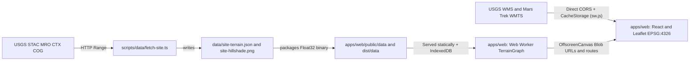

# Algorithms and architecture

This document covers the client-side deployment architecture (`deploy-v1`) for Mars Mission Planner. All file paths, symbols, constants, formulas, browser caches, and test counts come directly from the codebase under `packages/shared`, `apps/web`, and `scripts`. For function-level notes, see [Function reference](function-reference.md).

## Monorepo layout

The root `package.json`, named `mars-mission-planner`, configures Bun workspaces across `apps/*` and `packages/*`.

```text
packages/shared/src/     Coordinate geodesy, basemap tile URLs, binary DEM packing, TerrainGraph, spatial weather field, weather generator, and RSS parsers for @nimbs/shared
apps/web/src/            React and Leaflet console UI, terrain Web Worker, IndexedDB and localStorage caches, RGBA canvas overlay encoding, and client weather service for @nimbs/web
apps/web/public/         Service worker (sw.js) for tile and static asset CacheStorage, plus packaged static /data/* assets generated at build time
scripts/dev.ts           Launcher preparing static /data assets and running the @nimbs/web Vite dev server
scripts/serve-static.ts  Static-only Bun file server serving apps/web/dist/ with zero backend API routes
scripts/data/            Terrain and weather ingestion plus prepare-static-data.ts binary packager
scripts/assets/          FGDC geologic symbol extractor (extract-fgdc-symbols.ts)
data/                    Gitignored terrain grid, hillshade PNG, site-weather.json, and tracked SOURCES.md
docs/                    Visual language, tool extension guide, and architecture documentation
```

`@nimbs/shared` exposes `coords.ts`, `layers.ts`, `tiles.ts`, `types.ts`, `terrain/*`, and `weather/*` directly as TypeScript through `packages/shared/src/index.ts`. `@nimbs/web` runs all computations inside the browser and imports `@nimbs/shared` via `workspace:*`.



## Technology stack

Each dependency keeps deployment static-only while running all compute in the browser.

| Component | Version | Role and rationale |
| --- | --- | --- |
| Bun | `@types/bun` `1.2.5` | Runs workspace scripts, `scripts/serve-static.ts`, and `bun:test`. Zero backend application logic runs on the server. |
| React and Vite | `18.3.1` / `6.2.0` | Builds the static SPA bundle and Web Worker (`apps/web/dist/`) served by any static host or `bun run serve`. |
| Web Worker + Canvas | Native browser APIs | `apps/web/src/workers/terrainWorker.ts` runs `TerrainGraph` A*, weather fields, and zero-copy RGBA mask pixels; `rgbaBlob.ts` paints PNG `Blob`s via `OffscreenCanvas` / `HTMLCanvasElement`. |
| IndexedDB + Cache API + `localStorage` | Native browser storage | `browserCache.ts` caches the `3.82 MiB` binary DEM, live weather snapshots, computed route plans, and overlay PNG blobs in IndexedDB; `sw.js` caches static assets and external Mars basemap tiles in CacheStorage; `localStorage` restores waypoints, layers, and limits across reloads. |
| TypeScript | `5.7.3` | `tsconfig.base.json` sets `strict: true`, `noUncheckedIndexedAccess: true`, `isolatedModules: true`, `target: "ES2022"`, and `moduleResolution: "bundler"`. |
| Biome | `1.9.4` | Formats with 2-space indentation and `lineWidth: 100` while running `recommended` lint rules across `apps`, `packages`, and `scripts`. |
| `geotiff` | `2.1.3` | Pure TypeScript COG reader used by `scripts/data/fetch-site.ts` over HTTP Range requests during offline build preparation. |
| Leaflet | `1.9.4` | Uses `L.CRS.EPSG4326` directly so direct USGS WMS tiles, Mars Trek WMTS tiles, and site `L.imageOverlay` blob masks align cleanly. |

## Geodesy and site data pipeline

### Canonical Mars coordinates

`packages/shared/src/coords.ts` enforces one coordinate convention across ingest, routing, and display.

- **Latitude.** Planetocentric degrees clamped to `[-90, 90]` via `clampLat`, north positive.
- **Longitude.** East-positive degrees normalized into `[-180, 180)` via `normalizeLon180`, which maps `180` to `-180`. For UI display, `lon180To360` converts back to `[0, 360)`.
- **Reference sphere.** `MARS_RADIUS_M = 3_396_190` m, matching the Mars 2015 sphere used by USGS CTX and HiRISE COGs.
- **Equirectangular projection.** `equirectangularToCoord` and `coordToEquirectangular` convert between projected meters with `clon = 0` and `lat_ts = 0` and planetocentric degrees using `R = 3,396,190` m.
- **Great-circle distance.** `surfaceDistanceMeters(a, b)` applies the Haversine formula `2 * MARS_RADIUS_M * asin(min(1, sqrt(h)))`, normalizing longitudinal difference with `normalizeLon180(b.lon - a.lon)`.
- **Local degree scaling.** `metersToLatDeg` and `metersToLonDeg` convert metric widths to degrees, clamping `cos(lat)` to at least `1e-6`.

### Equirectangular DEM window extraction

`scripts/data/fetch-site.ts` extracts a local `20 km x 20 km` crop from wide-swath MRO CTX Controlled USGS COGs (`~20 m/px`, covering ~34 x 44 km, unlike narrow ~7.3 km HiRISE DTMs). It defines two site presets: `jezero` targeting `K23_062385_1988_XN_18N282W__K23_062451_1988_XN_18N282W` near `lat 18.664, lon 77.502`, and `mount-sharp` targeting `T01_000881_1752_XI_04S223W__P02_001752_1753_XI_04S222W` near `lat -4.81, lon 137.16`. Optional CLI flags `--size-km=...` and `--grid=...` override the default patch size and node count.

1. `fromUrl` opens the remote DTM COG header via HTTP Range requests, and `pickOverviewImage` selects an overview near `180 m/px` for candidate probing and an overview near `cellSizeM` for extraction.
2. Because equirectangular projection stretches east-west meters away from the equator, the script sets `widthProjM = 20000 / max(1e-6, cos(latRad))` and `heightProjM = 20000`.
3. The script probes 6 candidate windows around `centerHint` and the raster center (`[0, 0]`, raster center, and `+-0.1 * span` along X/Y). Valid pixels require finite numbers above `nodataValue + 10`. It picks near-complete windows (`validRatio >= 0.99`) and breaks ties by maximum topographic relief.
4. Centered on the chosen window, the script reads the full-resolution DTM subwindow (`1036 x 982` at `~20.39 m/px` for Jezero) and runs nodata-aware bilinear resampling onto `1001 x 1001` nodes rounded to `0.01 m`. Isolated nodata pockets are filled iteratively up to 3 passes using inverse-distance neighbor weights within a `9 x 9` kernel (`dr, dc in -4..4`).
5. For visual context, `pickOverviewImage` reads the matching hillshade COG subwindow at `~20 m/px`, blends raster relief (`0.8`) with analytical Horn hillshade computed from the `1001 x 1001` DTM (`azimuth 315 deg`, `altitude 38 deg`, weight `0.2`, falling back to `1.0` where raster hillshade is missing), tints RGB channels by `[0.94, 0.86, 0.78]`, and writes a `1000 x 1000` `data/site-hillshade.png` via `encodeRgbaPng`.

The fetched Jezero Crater Delta and Rim dataset in `data/site-terrain.json` contains `1001` rows by `1001` columns, `1,002,001` elevation nodes at `20 m` spacing across `1000` intervals, bbox `[77.26644047791001, 18.49529395141885, 77.62258148283172, 18.832706048581155]`, center `{ lat: 18.664, lon: 77.44451098037086 }`, and elevations between `-2590.35 m` and `-1696.52 m`.

### Basemap tile proxy and disk caching

`apps/api/src/routes/tiles.ts` proxies and caches global basemaps at `GET /api/tiles/:layer/:z/:x/:y`.

- **Layer mapping.** `USGS_WMS_LAYERS` maps `usgs-mdim` to `MDIM21_color`, `usgs-themis` to `THEMIS`, `usgs-mola-themis` to `MOLA_THEMIS_blend`, and `usgs-hillshade` to `HRSC_MOLA_Blend_Hillshade`. `mola-trek` fetches NASA Mars Trek MOLA colorized shaded relief JPEGs for `z <= 7`. In `packages/shared/src/layers.ts`, `MARS_BASE_LAYERS` exposes `usgs-mdim`, `usgs-themis`, `usgs-mola-themis`, and `mola-trek` to the frontend, with `usgs-mdim` as `DEFAULT_MARS_BASE_LAYER`.
- **Tile grid validation.** `EPSG:4326` spans `360°` by `180°`, so valid tile indices satisfy `0 <= z <= 14`, `0 <= x < 2^(z+1)`, and `0 <= y < 2^z`.
- **WMS request math.** For USGS layers, `tileDeg = 180 / 2^z`, `west = -180 + x * tileDeg`, `east = west + tileDeg`, `north = 90 - y * tileDeg`, and `south = north - tileDeg`. The proxy requests `256 x 256` `image/png` tiles from `planetarymaps.usgs.gov/cgi-bin/mapserv` using `WMS 1.1.1` and `SRS=EPSG:4326`.
- **Disk cache.** Tiles persist at `data/cache/tiles/<layer>/<z>_<x>_<y>.<ext>` using `.jpg` for `mola-trek` and `.png` for USGS layers. Upstream calls enforce a `12,000 ms` `AbortSignal.timeout` and reject non-image `content-type` headers with `502`. Responses set `Cache-Control: public, max-age=86400` and `X-Tile-Cache: HIT` or `MISS`.

## Terrain graph and pathfinding algorithms

`TerrainGraph` in `apps/api/src/terrain/engine.ts` loads `SiteDataset` elevations into a row-major `Float32Array` ordered north-to-south and west-to-east. From `meta.bbox`, the constructor measures exact Martian surface spacing along the grid midlines:

```text
dyM = surfaceDistanceMeters({ lat: north, lon: midLon }, { lat: south, lon: midLon }) / max(1, rows - 1)
dxM = surfaceDistanceMeters({ lat: midLat, lon: west }, { lat: midLat, lon: east }) / max(1, cols - 1)
```

### Graph structure, step distance, and slope

- **Vertices.** Cell `(r, c)` has linear index `idx = r * cols + c`. A vertex is valid when its elevation is finite and exceeds `nodataValue + 10`. `coordForCell(row, col)` maps cell indices linearly back to `[south, north]` and normalized `[west, east]`.
- **8-connected edges.** `DIRS` connects each valid vertex to 4 cardinal and 4 diagonal neighbors `[dr, dc]`.
- **Step distance.** `stepDist(dr, dc) = hypot(dr * dyM, dc * dxM)`.
- **Edge slope.** `edgeSlopeDeg` computes unsigned grade in degrees:

```text
dh = |elevations[idxB] - elevations[idxA]|
slopeDeg = atan(dh / max(1e-6, distM)) * 180 / pi
```

- **Global passability ratio.** `computePassableEdgeRatio(maxSlopeDeg)` scans the 4 forward directions `[0, 1]`, `[1, 0]`, `[1, 1]`, and `[1, -1]` so each undirected valid edge is counted once, returning `round((passable / total) * 1000) / 1000`.

### Priority queue and A* search

`planRoutes` clamps `maxSlopeDeg` to `[0.5, 89]` and checks `isInsideBounds` for both endpoints. `snapToNode` rounds fractional grid coordinates to the nearest valid cell, expanding outward in square rings of radius `1..5` if the exact pixel is nodata.

`runAStar(startIdx, goalIdx, maxSlopeDeg, mode)` uses a custom zero-allocation binary `MinHeap` (`popInto()` writing `poppedNode` and `poppedScore` instead of allocating objects) alongside preallocated reusable typed buffers (`Float64Array` `gScoreBuf`, `Int32Array` `parentBuf`, `Uint8Array` `closedBuf`, `Uint8Array` `validMask`). Neighbor passability avoids per-edge `Math.atan` by precomputing `maxDh[d] = tan(maxSlopeDeg) * dirDists[d]` for all 8 directions and comparing `abs(elev[v] - elev[u]) <= maxDh[d]`. The heuristic estimates remaining distance in meters on the local grid plane:

```text
h(r, c) = hypot((r - goalR) * dyM, (c - goalC) * dxM)
```

Because every strategy weight function returns at least `stepDist`, `h` is admissible and never overestimates path cost.

### Route strategies

`planRoutes` generates up to four distinct routes and deduplicates corridors using `overlapRatio(pathA, pathB) = sharedNodes / max(1, min(pathA.length, pathB.length))`.

1. **Shortest safe, `route-shortest`.** Strategy `"shortest"` uses `weightFn = (dist) => dist`. If no path exists under `clampedSlope`, `planRoutes` skips the remaining strategies and runs minimax Dijkstra.
2. **Lowest slope, `route-gentlest`.** Strategy `"gentlest"` penalizes steep steps quadratically relative to the limit:

```text
ratio = slopeDeg / max(1, clampedSlope)
cost = distM * (1 + 4.5 * ratio * ratio)
```

`planRoutes` appends this route only when `overlapRatio(gentlestPath, shortestPath) < 0.9`.

3. **Alternate corridor, `route-alternate`.** Strategy `"alternate"` populates the preallocated `Uint8Array` `penaltyBuf` across a scaled square block (`radius = clamp(2, 8, round(cols / 100))`, which is `8` cells or `160 m` on the `1001 x 1001` grid) around intermediate nodes of already discovered paths while excluding `startIdx` and `goalIdx`. Stepping onto a masked cell multiplies cost to `distM * 3.5`; unmasked steps cost `distM`. `planRoutes` appends this route only when `overlapRatio(alternatePath, existing) < 0.85` for all prior routes.

4. **Thermal safe, `route-weather-safe`** (conditional). Strategy `"weather-safe"` runs only when a weather filter is active with `thermalWeight > 0`, and `planRoutes` appends it only when `overlapRatio(weatherSafePath, existing) < 0.88` for every prior route. See "Spatial weather fields and weather-constrained routing" below.

`buildRouteSummary` records `totalDistanceM`, `elevationGainM`, and `elevationLossM` rounded to `0.1 m`, `maxSlopeDeg` and distance-weighted `meanSlopeDeg` rounded to `0.01°`, plus per-node `RoutePoint` entries with 6-decimal coordinates and incoming segment slopes.

### Minimax Dijkstra for unreachable thresholds

When `shortestPath` returns `null`, `findMinRequiredSlope(startIdx, goalIdx)` finds the lowest slope limit that connects A to B. Using preallocated `Float32Array` `bestSlopeBuf` and `MinHeap`, it relaxes neighbor edges with `candSlope = max(uSlope, edgeSlope)` and returns `ceil(heap.poppedScore * 10) / 10` as `minRequiredSlopeDeg` when `goalIdx` is popped, or `null` if no valid cell path exists.

### Bilinear elevation lookup and passability masks

- **Bilinear interpolation.** `elevationAt(coord)` maps coordinates to fractional `(r, c)`. When all four surrounding corner indices `(r0, c0)`, `(r0, c1)`, `(r1, c0)`, and `(r1, c1)` are valid, it interpolates linearly in both axes and rounds to `0.01 m`. If any corner is nodata, it falls back to the nearest rounded cell if valid, or returns `null`.
- **Passability mask PNG.** `renderSlopeMaskPng(maxSlopeDeg)` reads `localMaxSlope` precomputed once in the `TerrainGraph` constructor (`precomputeLocalMaxSlopes`) and encodes a `1001 x 1001` RGBA PNG via `encodeRgbaPng` at zlib compression level `1` (~23 ms encode time):
  - `localMaxSlope > maxSlopeDeg` writes amber-orange `rgba(245, 158, 11, 175)`, keeping terrain hazards visually separate from the `#de233d` selection accent.
  - `localMaxSlope > maxSlopeDeg * 0.75` writes caution yellow `rgba(234, 179, 8, 55)`.
  - Safer cells remain transparent `rgba(0, 0, 0, 0)`.

### Spatial weather fields and weather-constrained routing

`apps/api/src/terrain/weatherField.ts` turns a `MarsWeatherSnapshot` into per-cell temperature and pressure over the site grid, and `apps/api/src/terrain/engine.ts` folds that field into `planRoutes` as an optional `TerrainWeatherFilter` (`lmstHour`, optional `lmstLabel`, `minAirTempC`, `minPressurePa`, optional `thermalWeight`, and the `cellTempK`/`cellPressurePa` arrays).

**Hour interpolation.** `interpolateWeatherAtHour(snapshot, lmstHour)` clamps `lmstHour` to `[0, 48]`, floors to `h0`, takes `h1 = min(48, h0 + 1)`, and linearly blends `tempK`, `pressurePa`, and `solarIrradianceWm2` by the fractional hour. `isDaylight` is true when the blended irradiance is positive and either endpoint hour is daylight. `lsDeg` is interpolated with wrap when `snapshot.nextSol` is present, `sol` becomes `nextSol.sol` (or `snapshot.sol + 1`) past hour `24`, and dust opacity and reference elevation switch to `nextSol` for the second sol. `lmstLabel` is the wrapped `HH:MM` clock.

**Per-cell field.** `computeSiteWeatherField(graph, snapshot, lmstHour)` returns a `SiteWeatherField` holding `Float32Array` `tempK` and `pressurePa` plus `min`/`max`/`mean` summaries in Celsius and pascals. A `WeakMap` spatial cache per `TerrainGraph` precomputes:

- East-north-up surface unit normals from central differences of the elevation grid.
- A barometric height factor `exp(-elev / MARS_SCALE_HEIGHT_M)` with `MARS_SCALE_HEIGHT_M = 10_800`.
- Topographic basin depth from an `O(N)` separable sliding-window local mean, with radius `clamp(2, 10, round(200 / cellSizeMeters))`.

Pressure follows `p = pScale * exp(-elev / 10800)` where `pScale = sample.pressurePa * exp(referenceElevationM / 10800)`. Temperature starts from `baseTempAtZero = sample.tempK - MARS_LAPSE_RATE_K_PER_M * referenceElevationM` and adds `MARS_LAPSE_RATE_K_PER_M * elev` with `MARS_LAPSE_RATE_K_PER_M = -0.0025`. During daylight a solar term uses the sun unit vector built from `MARS_OBLIQUITY_RAD` (`25.19°`), season, latitude, and hour angle: `cosInc = normal · sun`, the incidence delta is clamped to `[-1.0, 1.2]`, and `solarAmp = 5.0 * exp(-0.55 * tau) * min(1.15, irradiance / 350)`. At night a clear-sky `exp(-0.3 * tau)` term cools basin cells up to `2.5 K` with a `0.02` per-meter pool slope. Field and PNG results are cached in small LRU maps (`8` fields, `16` PNGs) keyed by graph id, site, sol, scenario, and rounded sample values.

**Summary and masks.** `toSiteEnvironmentSummary(field)` returns the `SiteEnvironmentSummary` served by `GET /api/site/environment-summary`. `renderPressureMaskPng(graph, field, minPressurePa)` and `renderTemperatureMaskPng(graph, field, minAirTempC)` encode RGBA PNGs at the graph resolution through a 256-entry lookup table and `encodeRgbaPng` at zlib level `1`. The pressure mask shows blocked cells below `minPressurePa` in magenta-violet (`#d946ef` to `#a21caf`), a caution band below `minPressurePa * 1.04` in `#eab308`, and safe cells in a teal-cyan gradient (`#38bdf8` to `#0d9488`). The temperature mask shows blocked cold cells below `minAirTempC` in icy blue (`#0284c7` to `#2563eb`), a `5 °C` near-limit band in `#38bdf8`, and warm safe cells in amber-orange (`#f59e0b` to `#fb923c`).

**Hard filter and soft bias.** `buildWeatherContext` validates that both weather arrays match `totalCells`, clamps `thermalWeight` to `[0, 1]`, and derives the temperature and pressure spans used for scoring. `isCellWeatherPassable` then makes a cell impassable when its temperature is below `minAirTempK = celsiusToKelvin(minAirTempC)` or its pressure is below `minPressurePa`. `runAStar` returns `null` when the start or goal cell is impassable and skips impassable neighbors, so a hard filter can turn a route `unreachable`.

**Thermal risk.** `computeThermalRisk(idx, ctx)` blends a normalized temperature deficit (`0.55`), a normalized pressure deficit (`0.45`), and a proximity term (`0.6 * max(nearTemp, nearPress)`) that grows as a cell nears the temperature or pressure limit. When `thermalWeight > 0`, the `"gentlest"` mode adds `thermalWeight * 1.0 * risk` to its cost, and the `"weather-safe"` mode adds `thermalWeight * WEATHER_SAFE_THERMAL_GAIN * risk` (with `WEATHER_SAFE_THERMAL_GAIN = 80`) while weighting slope more lightly (`stepCost = dist * (1 + thermalTerm + 0.5 * ratio * ratio)`). The resulting route is emitted as id `route-weather-safe`, label `THERMAL SAFE`, strategy `"weather-safe"`, and only when it differs from every prior route by `overlapRatio < 0.88`.

**Unreachable diagnosis.** When the slope-only path is blocked and a weather filter is active, `diagnoseUnreachable` runs temperature-only and pressure-only A* passes to classify `blockedReason` as `"temperature"`, `"pressure"`, or `"combined"`, then `findMaxFeasibleNodeValue` (a maximin Dijkstra over slope-passable edges) reports `maxFeasibleMinTempC` and `maxFeasibleMinPressurePa`, the warmest and highest-pressure corridors still reachable. `buildRouteSummary` attaches per-point `tempC` and `pressurePa` and route `minTempC`/`maxTempC`/`minPressurePa`/`maxPressurePa` when a weather filter is present.

## Frontend architecture

### ToolRegistry and layout structure

`apps/web/src/registry/toolRegistry.ts` manages rail tools via `ToolRegistry` methods `register`, `list` sorted ascending by `order`, and `get`. Following `docs/adding-tools.md`, `apps/web/src/App.tsx` registers five tools on the 64px vertical `.tool-rail` alongside a compact `BSC` / `ADV` mode switch:

- `BSC` (basic mode): replaces parameter sliders in `RTE`, `WXR`, and `SET` with `TraversePresetControl` (`HUMAN` EVA suit vs `ROVER` pressurized vehicle presets), and switches `PTS` and marker popups/context menus to read-only point viewing while keeping `A` and `B` route waypoint placement active.
- `ADV` (advance mode): exposes all slope, EVA threshold, and traverse speed sliders plus full map point and custom class creation, editing, and deletion.
- `route`, rail label `RTE`, order `1`: waypoint readouts, `TraversePresetControl` (in `BSC`) or `MaxSlopeControl` (in `ADV`), a `WEATHER ROUTING` toggle with a `T >= ... / P >= ... / LMST` strip, route strategy buttons, route weather check summary, summary stats, and `ElevationProfile`.
- `points`, rail label `PTS`, order `2`: classified map markers, per-class visibility toggles, and (in `ADV`) class creation and themed symbol selection (`ThemedIconPicker`).
- `weather`, rail label `WXR`, order `3`: `WeatherPanel` with a full `TimeSimulationControl`, NASA/PDS weather telemetry, simulated/hybrid provenance notice, scenario selector (`auto`, `nominal`, `dust-storm`, `cold-snap`), 24-hour LMST forecast strip, the 48-hour `TraverseWindowsPanel`, and either `TraversePresetControl` (`BSC`) or 5 EVA constraint sliders plus 3 traverse speed sliders (`ADV`).
- `layers`, rail label `LYR`, order `4`: global basemap selector and toggles for the local site hillshade, slope hazard mask, pressure overlay, temperature overlay, and site bounding box, plus a compact `TimeSimulationControl`.
- `settings`, rail label `SET`, order `5`: `TraversePresetControl` (`BSC`) or `MaxSlopeControl` (`ADV`), graph edge passability percentage, `-180..180` versus `0..360E` longitude display toggle, DEM grid stats, and a button to re-center on the local site patch.

### Classified points and FGDC symbology

`scripts/assets/extract-fgdc-symbols.ts` extracts 31 CC0-licensed SVG path icons from `geologic-symbols-qgis` (`src/` directory) into `apps/web/src/assets/fgdcSymbols.ts`, grouped into 5 themes so the picker never displays all icons at once:

- `eva` (`EVA`): site beacons, markers, outcrops, anomalies, samples, vents, boulders, crater rims, and terrain contacts.
- `tectonics` (`FAULT`): normal, reverse/thrust, and strike-slip faults, fractures, bedding, and anticline/syncline axes.
- `volcanic` (`VOLC`): domes, flows, vents, dikes, collapse calderas, and lava channels.
- `craters` (`CRAT`): crater rims, central peaks, impact ejecta, escarpments, and dune fields.
- `surface` (`SURF`): channels, ridges, scarps, sand dunes, cobble units, and dust deposits.

`apps/web/src/components/PointClassIcon.tsx` renders both the 7 built-in core icons (`16 x 16`) and the 31 FGDC icons (`24 x 24`) through `parseStaticSvgNodes` (`PointClassIcon` for React and `createPointIconSvgElement` for Leaflet DOM markers without HTML string injection). `apps/web/src/services/pointStore.ts` persists classes, per-point optional FGDC `icon` overrides, and class visibility in `localStorage`.

### Mars weather acquisition, generator, and EVA feasibility

Live NASA InSight weather endpoints no longer return current data (`mars.nasa.gov` Insight feed has an empty `sol_keys` array and `api.nasa.gov` `DEMO_KEY` rate-limits with HTTP 429). `scripts/data/fetch-weather.ts` and `apps/web/src/services/clientWeather.ts` combine live rover feeds with PDS archive snapshots bundled at `/data/site-weather.json`:

- Real channels: `ClientWeatherService` probes direct CORS NASA Perseverance MEDA RSS and MSL REMS RSS with a 4s timeout and falls back to `/data/site-weather.json` (plus IndexedDB cache) populated from `atmos.nmsu.edu` PDS4 MEDA (`DER_PS`, `CAL_ATS`, `DER_ANCILLARY`) and PDS3 REMS (`RME_*RMD*.TAB`).
- Diurnal physics generator: `packages/shared/src/weather/generator.ts` scales barometric pressure to target or crater-rim elevation using Martian scale height `MARS_SCALE_HEIGHT_M = 10_800` m (`P(z) = P_ref * exp(-(z - z_ref) / 10800)`) and adjusts air temperature with `MARS_LAPSE_RATE_K_PER_M = -0.0025` K/m. Seasonal pressure follows a two-harmonic CO2 condensation cycle, wind directions map into 16 compass sectors (`N` through `NNW`), and dust opacity `tau` attenuates solar irradiance via Beer-Lambert scaling.
- Explicit provenance: every `MarsWeatherSnapshot` records `isSimulated`, `sourceType` (`"real"`, `"hybrid"`, or `"simulated"`), `realChannels`, `simulatedChannels`, and a `disclaimer` string displayed in the `WXR` sidebar. Missing channels (such as MEDA wind after Sol 315 or dust-storm scenario overrides) are explicitly marked simulated.
- EVA evaluation: `evaluateEvaWeather` scales pressure and temperature to `route.maxElevationM` (defaulting to the site's maximum elevation rim), evaluates 5 interactive threshold checks (`air_temp`, `wind_speed`, `pressure`, `pressure_swing`, `eva_duration`) returning `GO`, `DEGRADED`, or `NO-GO`, estimates traverse duration from `totalDistanceM / limits.flatSpeedMPerH + elevationGainM / limits.climbSpeedMPerH + elevationLossM / limits.descentSpeedMPerH` (defaulting to `2500`, `350`, and `800` m/h), and selects the longest contiguous safe daylight traverse window (`safeWindow`).
- Spatial field and 48-hour timeline: `computeSiteWeatherField` projects the snapshot onto the site grid at a given LMST hour (see "Spatial weather fields and weather-constrained routing"), and `evaluateEvaWeather` accepts an `lmstHour` that fills a `selectedHourWeather` floor and rim summary plus a 48-hour `departureSlots` timeline and ranked `recommendedWindows` of `TraverseWindowRecommendation`. The `WXR` panel drives both from the `TimeSimulationControl` slider.

When `panelOpen` is true, the `64px` `.tool-rail` plus `416px` `.side-panel` equals `480px`, matching `--sidebar-width` in `apps/web/src/styles/tokens.css`, and shifts `.map-hud` left offset from `64px` to `480px`.

### Leaflet alignment, overlays, and waypoint flow

`apps/web/src/components/MapView.tsx` initializes Leaflet with `crs: L.CRS.EPSG4326`, center `[18.46, 77.523]`, initial zoom `13`, `minZoom: 1`, `maxZoom: 17`, `zoomControl: false`, and `attributionControl: false`.

- Basemap `L.tileLayer` subclasses (`DirectMarsTileLayer`) compute direct CORS USGS WMS 1.1.1 EPSG:4326 bounding-box URLs and Mars Trek WMTS tile URLs via `buildDirectMarsTileUrl`, while `public/sw.js` caches tile responses in browser CacheStorage (`nimbs-tiles-v1`).
- The local `L.imageOverlay` renders static `/data/site-hillshade.png` at `opacity: 0.9`, while slope hazard (`zIndex: 4`, `opacity: 0.78`), temperature (`zIndex: 2`), and pressure (`zIndex: 3`) overlays are rendered as RGBA arrays in `terrainWorker.ts`, encoded into PNG `Blob` URLs on the client, and cached in IndexedDB (`nimbs-mars-cache-v1`).
- Terrain overlay effects in `MapView` isolate static overlays (hillshade + bounding box) from slider updates, cancelling in-flight worker renders when controls change before `150..160 ms` debounce settles.
- On `zoomend`, `moveend`, and `resize`, `updateScale` measures `surfaceDistanceMeters` across a `120 px` horizontal span at viewport center and picks the largest entry in `NICE_SCALE_METERS` from `50 m` to `500 km` that fits within `110 px`.
- Right-clicking the map prevents the browser context menu, normalizes longitude with `normalizeLon180`, and opens `apps/web/src/components/ContextMenu.tsx` clamped within `window.innerWidth - 230` and `window.innerHeight - 150`. Selecting Set A Waypoint or Set B Waypoint updates coordinates, switches to the `route` tool, and opens the side panel.
- Moving the pointer inside `site.bbox` queries `terrainWorker.ts` (`fetchElevation`) after a `45 ms` debounce for the top-right `ELEVATION` HUD readout.

### Reactive slope filtering, comparison UI, and telemetry profile

- `apps/web/src/components/MaxSlopeControl.tsx` binds a `1..45°` slider with `0.5°` steps to a `0.5..60°` numeric input with `0.5°` steps.
- `apps/web/src/components/RoutePlannerPanel.tsx` and `apps/web/src/components/routeVisuals.ts` replace multi-box waypoint/metric text readouts with a unified `A <-> B` corridor strip (with inline swap and clear controls), a compact constraint + graph passability bar, graphical blocked-threshold comparison bars when `status !== "ok"`, and candidate route cards carrying inline elevation sparklines, strategy glyphs, relative distance/slope bars, and weather chips.
- Any change to `waypointA`, `waypointB`, `maxSlopeDeg`, the weather routing toggle, scenario, `simLmstHour`, or the temperature/pressure limits triggers a `120 ms` debounced `planGraphRoutes` call in `terrainWorker.ts` with cancellation on superseded requests and IndexedDB route caching, while `MapView` debounces `renderSlopeMaskUrl` updates by `150 ms`.
- Candidate polylines in `MapView` sort so the active `selectedRouteId` renders on top in `#de233d` (`3.5 px` over a `#050709` `6.5 px` contrast halo). Unselected alternatives render interactively in strategy-coded dashed strokes (`#e5e0dc` fastest, `#38bdf8` flattest, `#eab308` detour, `#3fb68b` thermal) with sticky hover tooltips and click-to-select behavior.
- `apps/web/src/components/ElevationProfile.tsx` renders a `384 x 148` multi-layer SVG chart pairing the filled elevation profile with a baseline slope hazard ribbon (`#3fb68b`, `#eab308`, `#de233d`), toggleable `ALL`/`SLP`/`T°`/`Pa` route temperature and pressure curves with suit threshold lines, live hover crosshair telemetry, and `.profile-hover-dot` map tracking.
- Point, class, and picker icons in `apps/web/src/assets/milStd2525c.ts` and `apps/web/src/components/PointClassIcon.tsx` use 30 vector MIL-STD-2525C tactical symbols (`24x24` `currentColor` frames with 15-character SIDC codes) grouped across `UNITS`, `BASE`, `HZD`, `TAC`, and `METOC` themes, preserving automatic migration for legacy `fgdc-*` IDs in local storage.

### Time simulation and weather layers

- `apps/web/src/components/TimeSimulationControl.tsx` renders an LMST hour slider over `0..47.5` at `0.5` steps, quick-jump buttons at `07:00`, `12:00`, `15:00`, and `22:00` (`QUICK_JUMP_HOURS`), a `PLAY`/`PAUSE` toggle, a `DAYLIGHT`/`NIGHT` tag, a `SOL n` readout, and a `+1D` badge past hour `24`. `clampSimLmstHour` clamps and rounds to `0.5`, `formatLmstClock` renders `HH:MM`, and `estimateLocalWeatherAtElevation` scales the cursor readout by `exp(-deltaElev / 10800)` for pressure and `-0.0025` K/m for temperature.
- `apps/web/src/App.tsx` holds `simLmstHour` (default `12`). While playing it advances `0.5` hours every `600 ms` and wraps at `48`. The control also appears in compact form inside the `layers` tool.
- `WeatherPanel` embeds the control and `TraverseWindowsPanel`, which draws the 48-hour `departureSlots` timeline with a cursor at the active hour and a ranked `recommendedWindows` list; each slot and window jumps the simulation time.
- The `layers` tool toggles `PRESSURE OVERLAY (PA)` and `TEMPERATURE OVERLAY (°C)`. `MapView` renders the matching client-side mask blobs, and the HUD shows a legend with the field min and max computed by `terrainWorker.ts`.

### Visual language alignment

`apps/web/src/styles/tokens.css` and `apps/web/src/styles/app.css` implement `docs/visual-language.md`: dark surfaces `#050709`, `#0c0e11`, and `#15181c`; warm off-white text `#fff8f3`; square corners via `--radius: 0`; `1px` borders; `12px` bottom-right clipped corners on `.chamfer-btn`; `Inter` and `JetBrains Mono` with `tabular-nums`; corner brackets on `.map-hud`; and `#de233d` reserved for active selection. Warning states use `--color-warn: #eab308` added to `tokens.css`, while slope hazard overlays and alert borders use `#f59e0b` directly in `engine.ts`, `ElevationProfile.tsx`, and `app.css` rather than reusing the red accent.

## Static asset serving and client caching

The `deploy-v1` architecture removes `apps/api` and runs all terrain routing, weather modeling, and overlay rendering in the browser. The server hosts static files only.

### Static dataset bundle (`scripts/data/prepare-static-data.ts`)

`scripts/data/prepare-static-data.ts` packages raw files from `data/` into `apps/web/public/data/`:

| Static file | Source | Format and purpose |
| --- | --- | --- |
| `/data/site-meta.json` | `data/site-terrain.json` | Grid metadata (`StaticSiteManifest`) excluding raw elevation arrays |
| `/data/site-terrain.bin` | `data/site-terrain.json` | Little-endian `Float32Array` binary storing `rows * cols` elevation values in meters |
| `/data/site-hillshade.png` | `data/site-hillshade.png` | Pre-rendered static hillshade raster overlay |
| `/data/site-weather.json` | `data/site-weather.json` | Persisted NASA MEDA/REMS observations used as a static fallback |

### Direct upstream tiles and weather

`packages/shared/src/tiles.ts` and `packages/shared/src/layers.ts` resolve map tile coordinates directly to CORS-enabled upstream endpoints via `buildDirectMarsTileUrl`:

- USGS Astrogeology WMS (`USGS_WMS_BASE_URL`) and JPL Mars Trek WMTS (`MARS_TREK_MOLA_TILE_TEMPLATE`) serve base map tiles directly to Leaflet (`DirectMarsTileLayer`) with `crossOrigin: "anonymous"`.
- `ClientWeatherService` (`apps/web/src/services/clientWeather.ts`) probes direct CORS NASA MEDA/REMS RSS feeds with a 4 s timeout, caches snapshots for 15 minutes in memory and IndexedDB, and falls back to `/data/site-weather.json`, stale IndexedDB data, or deterministic `generateMartianWeather`.

### Client compute and browser persistence layers

- **Web Worker and engine (`apps/web/src/workers/terrainWorker.ts`, `apps/web/src/services/clientEngine.ts`):** Decodes `/data/site-terrain.bin`, builds `TerrainGraph`, runs elevation lookups, plans four-strategy A-B routes (`FASTEST`, `FLATTEST`, `THERMAL`, `DETOUR`), computes site environment summaries, and returns zero-copy transferable RGBA buffers for slope, pressure, and temperature masks. `apps/web/src/services/rgbaBlob.ts` encodes masks to PNG `Blob` object URLs (LRU cache max 32 entries). Falls back to in-thread execution if `Worker` is unavailable.
- **IndexedDB (`apps/web/src/services/browserCache.ts`, DB `nimbs-mars-cache-v1`):** Persists `datasets`, `weather`, computed PNG `overlays` (LRU max 24), and cached `routes` (LRU max 32).
- **`localStorage`:** Persists mission, waypoint, layer, and weather UI state under `nimbs.mars-mission-state.v1` and map point classes under `nimbs.mars-map-points.v1`.
- **Service Worker (`apps/web/public/sw.js`):** Caches static assets and `/data/*` in `nimbs-static-v1` (`CacheStorage`) and caches upstream USGS WMS / Mars Trek tiles in `nimbs-tiles-v1` (LRU max 600 tiles).

### Static file host (`scripts/serve-static.ts`)

`scripts/serve-static.ts` serves `apps/web/dist/` on `HOST` (default `0.0.0.0`) and `PORT` (default `3000`). It contains no `/api/*` routes.

## CLI commands and verification

Root `package.json` defines these scripts:

```sh
bun install
bun run fetch-site
bun run fetch-site --site=mount-sharp
bun run fetch-weather
bun run build:data
bun run dev
bun run build
bun run serve
bun run start
bun run typecheck
bun run lint
bun test
```

If `bun` is installed at `~/.local/bin/bun` outside the default shell `PATH`, export `PATH="$HOME/.local/bin:$PATH"` first or call `~/.local/bin/bun` directly. `scripts/dev.ts` spawns child processes using `process.execPath`, so launching `scripts/dev.ts` with `~/.local/bin/bun` propagates that binary.

### Automated test suites and lint scope

The repository runs 32 `test` cases across 6 test files:

- `packages/shared/src/coords.test.ts`: checks `[-180, 180)` longitude normalization, USGS Jezero HiRISE origin round-trip transforms, and `surfaceDistanceMeters` against `metersToLatDeg` and `metersToLonDeg`.
- `packages/shared/src/terrain/engine.test.ts`: verifies `TerrainGraph` slope detours, `unreachable` threshold recovery (`minRequiredSlopeDeg`), `out_of_bounds` handling, slope/pressure/temperature RGBA mask generation, and weather-constrained routing with 48-hour wrap interpolation.
- `packages/shared/src/terrain/real-site.test.ts`: gated on `data/site-terrain.json`, verifies `1001 x 1001` Jezero grid loading, binary terrain round-trip, elevation queries, `minRequiredSlopeDeg` recovery, passability RGBA overlay rendering, and static hillshade asset validation.
- `packages/shared/src/weather/weather.test.ts`: verifies barometric scale height adjustment, compass sectors and `K`/`C` conversions, nominal/dust-storm/cold-snap scenarios, hybrid real-channel provenance, crater-rim pressure checks, thermal daylight windows, MEDA RSS `--` filtering, and direct Mars basemap URL generation.
- `apps/web/src/services/pointStore.test.ts`: checks point filtering by class visibility, custom class creation and `localStorage` persistence, corrupted payload recovery, MIL-STD-2525C catalog and 15-char SIDC validation, legacy FGDC icon migration, and unknown icon stripping.
- `apps/web/src/services/clientCache.test.ts`: verifies `loadMissionState`/`saveMissionState` validation and persistence plus `ClientWeatherService` fallback behavior.

`bun run lint` runs `biome check apps packages scripts`, checking `apps/`, `packages/`, and `scripts/` while ignoring `docs/`, `data/`, `local/`, `node_modules/`, `dist/`, and `apps/web/src/styles/tokens.css` per `biome.json`.
