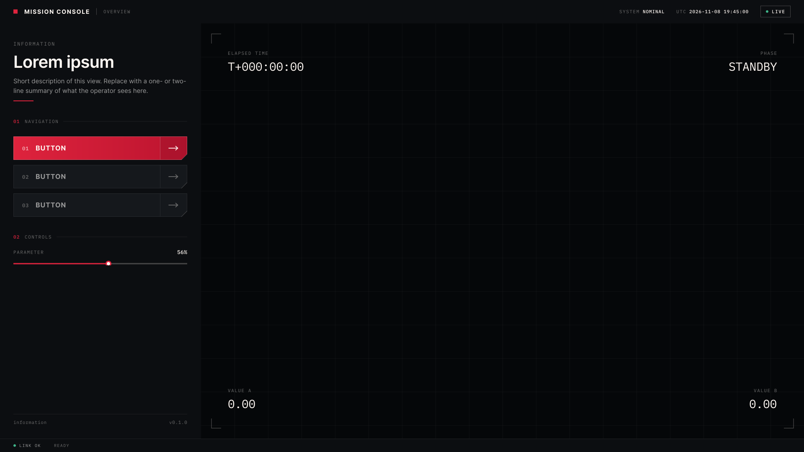

# Visual language

Source: [Figma frame](https://www.figma.com/design/xRsXzeKw6fl8MdyWuNOsxh/Untitled?node-id=10-78). Snapshot: [mission-console.png](assets/mission-console.png) ([svg](assets/mission-console.svg)). Tokens: [`apps/web/src/styles/tokens.css`](../apps/web/src/styles/tokens.css).

The app is a dark instrument panel with a map in the middle. It should read like a tool for a person in a spacesuit. Every pixel on screen is either the map or something the astronaut needs.

## Only show what carries information

This is the rule agents break most often, so it comes first.

The Figma frame is a template. Its placeholder labels are not part of the design. Don't build these:

| In the frame | Why it goes |
| --- | --- |
| OVERVIEW next to the logo | The page itself shows which view you're on. |
| INFORMATION above the title | The title is the information. |
| 01 NAVIGATION, 02 CONTROLS section headers | Buttons and sliders explain themselves. A group gets a header only when two groups would otherwise be confused. |
| 01, 02, 03 on buttons | Numbers mean order. Use them only where order is real, like route waypoints or EVA steps. |
| SYSTEM NOMINAL, LIVE, LINK OK, READY | There's no system behind them. Fake status is worse than none. |
| "information" and v0.1.0 in the sidebar footer | Nobody on Mars needs the build number. |

Before adding any label, badge, header or status, ask what the astronaut would do differently after reading it. If the answer is nothing, leave it out. Status indicators come back only when they show real state from real data, like the timestamp of the last weather reading.

Labels that do earn their place are the ones naming a value: ELAPSED TIME, SLOPE, DOSE RATE. A number without its label is useless.

## Layout

Designed at 1920x1080.

- Top bar, 56px. Logo mark and product name on the left. Right side is free for things that matter, like the mission clock (UTC and local solar time).
- Sidebar, 480px, left. Title, short description, then the controls for the current view. 32px padding.
- Map canvas, the rest. Corner brackets frame it. Readouts pin to the corners in mono.
- Status bar, 32px, bottom. Keep it only if it holds real state. Otherwise drop it and give the map the space.

The 80px grid on the canvas is a placeholder. The map replaces it. A faint grid can stay as an overlay if it maps to a real distance, like 100 m.

## Color

| Token | Value | Use |
| --- | --- | --- |
| `--color-bg` | `#050709` | Page and map background |
| `--color-surface` | `#0C0E11` | Top bar, sidebar |
| `--color-surface-raised` | `#15181C` | Buttons, cards |
| `--color-text` | `#FFF8F3` | Main text. Warm off-white, never `#FFF` |
| `--color-text-muted` | `#9A9A9A` | Descriptions |
| `--color-text-dim` | `#6C6C6C` | Value labels |
| `--color-line` | text at 8% | Dividers, idle borders |
| `--color-line-strong` | text at 24% | Active borders, slider track |
| `--color-accent` | `#DE233D` to `#BC142F` | The primary action and the current selection |
| `--color-ok` | `#3FB68B` | Healthy, real status only |

Red is rare on purpose. If two things on screen are red, one of them is wrong. Hazard colors on the map (slope, radiation) need their own scale, defined when we build those layers. Don't reuse the accent for danger.

## Type

Two families. Sans for titles and buttons, mono for labels and numbers. The export outlined the text, so the font names are guesses until someone checks Figma: Inter for sans, JetBrains Mono for mono.

| Role | Size | Style |
| --- | --- | --- |
| Title | 40px | Sans, bold |
| Body | 15px | Sans, muted |
| Button | 16px | Sans, bold, uppercase |
| Value label | 11px | Mono, uppercase, 0.16em tracking, dim |
| Readout | 28px | Mono |

Numbers are always mono so digits don't jump around as they change.

## Shape

- Square corners. No radius anywhere.
- 1px borders. No shadows, no blur, no glow.
- Primary buttons have a 12px clipped bottom-right corner. It's the one decorative detail, so don't add others.
- Corner brackets mark the edges of the map.

## Components in the frame

Button. 56px tall, full sidebar width, label left, a 64px arrow cell on the right. Primary uses the red gradient. Secondary uses the raised surface with an 8% border.

Slider. 3px track. Red fill up to a white thumb with a red ring, 24% line after it. Value label on the left, current value in mono on the right.

Readout. Value label on top, mono number below. Units go in the number line ("18°", "0.67 mSv/day"), not the label.

## Writing in the UI

Uppercase for value labels, sentence case for the sidebar description. Short readouts: "SLOPE 18°", not "Moderate terrain difficulty". No full sentences on the map. The `unslop` skill applies here too.

## References

Things worth looking at for ideas. Take ideas from them, not their look.

- [JPL Mars Trek](https://trek.nasa.gov/mars/). What Mars layers look like when stacked. Also an example of a UI built for scientists, not astronauts.
- [Curiosity's proposed path up Mount Sharp](https://science.nasa.gov/resource/curiositys-proposed-path-up-mount-sharp/). How NASA draws a route with labeled science regions.
- [NASA Eyes on the Solar System](https://eyes.nasa.gov/apps/solar-system/). Dark 3D space UI with minimal chrome.
- [NASA Graphics Standards Manual (1975)](https://www.nasa.gov/nasa-brand-center/). The worm-era design system. Short on decoration, strict grid, red as the one accent.
